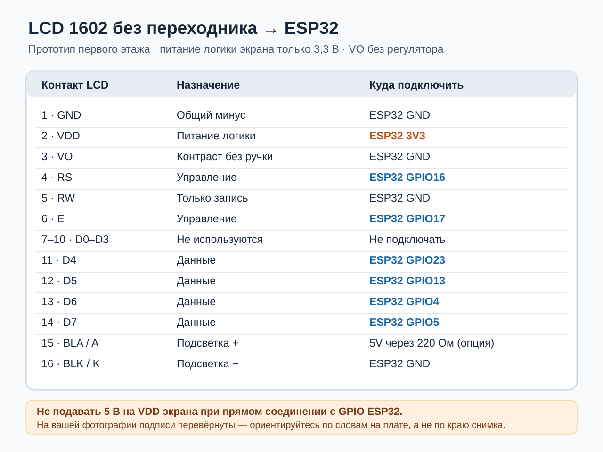

# Экран 1602 на первой станции без переходника

На присланном экране написано `1602A Ver5.5`. Сзади нет I²C-переходника:
четырёхпроводное подключение `GND/VCC/SDA/SCL` здесь **невозможно**.
Эта версия прошивки умеет управлять голым экраном в четырёхбитном режиме.
Прежде чем вырезать окно в корпусе, проверьте экран рядом с ESP32 на столе.

## Что уже сделано

- При предыдущем подключении к компьютеру ESP32 находилась на `COM6`, имеет 4 МБ Flash.
- Программа и файловая система с примером мелодии записаны в эту плату.
- Ей присвоен номер `1` — первый этаж; имя Bluetooth после перезапуска:
  `HOUSE-1F-2944D57C`.
- Подтверждено через USB: `HOUSE-1F-2944D57C ROOM 1 IDLE`.
- Сеть `YOUR_WIFI_SSID` настроена, пароль сохранён в ESP32; USB показал `UDP ready`.
- По сообщению владельца экран первой коробки показывал `1F READY`.
  Большая и четыре маленькие кнопки проверены через USB; микрофон передаёт
  данные, а локальная тестовая речь после перепайки проводов звучала чисто.

## Подключение экрана к ESP32

**Отключите USB перед прокладкой каждого провода.** Следуйте надписям на
плате экрана. На присланном снимке надписи перевёрнуты, поэтому не
ориентируйтесь на «левый» и «правый» контакт. На экране одна линия из
16 отверстий; используйте следующие контакты.

| Контакт LCD | Надпись | Подключить |
|---:|---|---|
| 1 | `GND` | ESP32 `GND` |
| 2 | `VDD` | ESP32 **`3V3`** |
| 3 | `VO` | `GND` — фиксированная максимальная контрастность |
| 4 | `RS` | ESP32 `GPIO16` |
| 5 | `RW` | `GND` — экран работает только на запись |
| 6 | `E` | ESP32 `GPIO17` |
| 7–10 | `D0`–`D3` | Не подключать |
| 11 | `D4` | ESP32 `GPIO23` |
| 12 | `D5` | ESP32 `GPIO13` |
| 13 | `D6` | ESP32 `GPIO4` |
| 14 | `D7` | ESP32 `GPIO5` |
| 15 | `BLA` или `A` | Для подсветки: от `5V` через отдельный резистор **220 Ом** |
| 16 | `BLK` или `K` | `GND` |

Контакты `1`, `3`, `5` и `16` можно соединить с общей землёй. Выводы
`GPIO4` и `GPIO5` используются для выбора режима загрузки ESP32; не
добавляйте к этим проводам подтягивающие резисторы или кнопки. Сам экран
получает питание логики **только 3,3 В**. Не переставляйте `VDD` на 5 В:
для неизвестного контроллера этого модуля тогда нельзя гарантировать
совместимость его входов с 3,3‑вольтовыми выводами ESP32. Цепь подсветки
отдельная; резистор 220 Ом нужен даже если на плате уже есть свой.

`VO` можно сразу соединить с GND, как вы и предложили: ручка контраста
для первого опыта не нужна. Если при 3,3 В будут видны только квадраты,
пустое поле или очень бледные символы, сначала перепроверьте соединения.
Возможность нормального контраста именно вашего экземпляра при 3,3 В
проверяется только включением. Если он не заработает, понадобится
переходник I²C и согласование уровней для работы от 5 В либо другой экран.

## Что должно появиться

На первой коробке экран физически установлен вверх ногами, а длина проводов
не позволяет повернуть модуль. Прошивка для **номера 1** рисует символы
повёрнутыми на 180°, меняет местами строки и разворачивает порядок букв.
После подключения к `YOUR_WIFI_SSID` сверху будет `1F`, снизу — `READY`. При потере
сети снизу будет `NO WIFI`. При удержании малых кнопок появятся `TO 2F`,
`TO 3F-A`, `TO 3F-B` или `TO 4F`; большая кнопка покажет `TO ALL`.
Входящий голос обозначен `VOICE IN`, будильник — `ALARM`, таймер — `T 00:00`.
Для таймера менее часа указаны минуты и секунды, от часа — часы и минуты.

LCD1602 допускает только восемь нарисованных программой символов одновременно,
поэтому подписи на первой коробке сокращены. На остальных коробках, если
поставить LCD в обычном положении, остаётся прежний полный формат:
`2F READY`/`PRESS TO TALK` и подробные состояния для соответствующего номера.

Экран не нужен для работы переговорной связи: эту же прошивку можно
залить на остальные точки без подключённого LCD. В `include/config.h`
дисплей включён флагом `HOUSE_LCD1602_DIRECT 1`.

## Адреса пяти точек

| Номер в памяти | Место | Короткая надпись на экране и в имени Bluetooth |
|---:|---|---|
| 1 | Первый этаж — текущая коробка | `1F` |
| 2 | Второй этаж | `2F` |
| 3 | Третий этаж, комната 1 | `3F-A` |
| 4 | Третий этаж, комната 2 | `3F-B` |
| 5 | Четвёртый этаж | `4F` |

На **первой** коробке малые кнопки сверху вниз: К1 → №2, К2 → №3,
К3 → №4, К4 → №5. На других коробках программа пропускает их собственный
номер и назначает четырём кнопкам оставшиеся номера по возрастанию.
Для следующей платы номер можно записать через USB: открыть порт 115200,
отправить строку `ROOM 2` с Enter и нажать `EN`/`RESET`. Команда `STATUS`
покажет сохранённый номер. Программу перекомпилировать не нужно.
