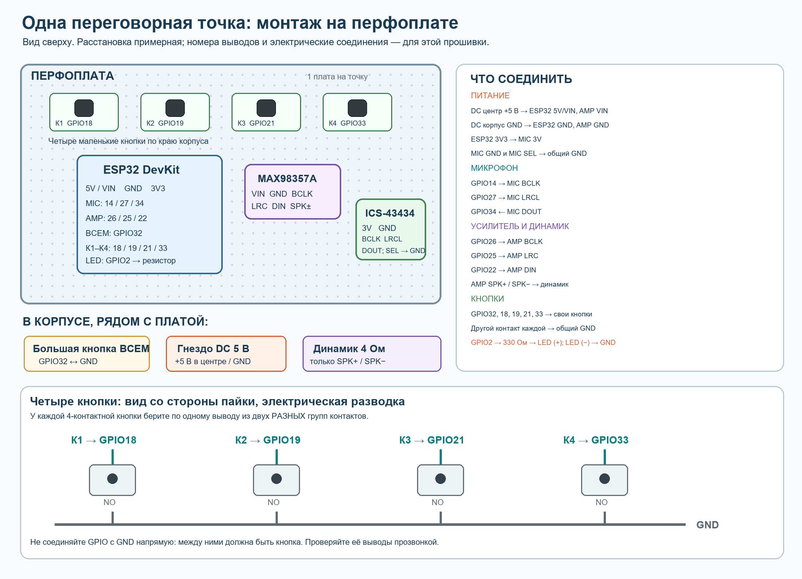

# Домашняя переговорная связь на 5 точек

Проект под уже заказанные ESP32 DevKit, цифровые микрофоны ICS-43434,
усилители MAX98357A и динамики SOTAMIA 4 Ом. Каждая точка питается от
отдельного блока 5 В через розетку. Схемы лежат в `diagrams/`.

**Состояние на 18.10.2026:** первая ESP32 — этаж 1, экран повёрнут
программно на 180°; его надписи и локальный звук проверены. Вторая ESP32
`38:3e:51:59:62:80` — этаж 2, без экрана; большая кнопка перенесена на
GPIO23, все пять кнопок проверены по USB, локальный звук и приём голоса с
первой коробки работают. На второй при `TEST MIC` оба канала выдавали только
нули; микрофон требует отдельной проверки. Независимая от микрофона мелодия
по двойному К1 передавалась в сеть: компьютер получил 58 пакетов с ненулевым
звуком и адресом этажа 1. Первая коробка не реагировала ни на эту мелодию,
ни на мелодию и команду таймера с компьютера. Её UDP-сокет получил пакет,
посланный себе самой, но счётчик внешних входящих пакетов остался нулевым.
Это отдельная проблема входящей сети первой коробки; не следует объяснять её
только микрофоном. Эксперимент с обменом IP-адресами и прямой отправкой
ухудшил работу: пропал и ранее работавший путь с первого этажа на второй.
Поэтому обе коробки 18.10.2026 возвращены к отправке по широковещательному
адресу. На первой запись прошла после снижения скорости USB до 115200 бод.
Причина отсутствия входящего звука выявлена диагностической сборкой: при
отключении тяжёлого BLE-стека свободная память выросла примерно с 35 до
196 КБ, первая приняла 58/58 пакетов тестовой мелодии и заиграла чисто.
Затем на обе коробки записана сборка с NimBLE-Arduino 1.4.3: свободно около
93 КБ, обе подключились к Wi-Fi и BLE; компьютер обнаружил каждую по BLE,
подключился и прочитал статус `IDLE`. Приём аудиопакетов по Wi-Fi возобновился.
Однако при проверке между коробками обе мелодии хрипят и заикаются. Чистое
воспроизведение тестовой мелодии с компьютера на первой проверено отдельно;
устойчивость связи между коробками и речь пока не подтверждены. Пользователь
отключил коробки и отложил продолжение до следующего дня. Следующий тест:
сравнить число, порядок и интервалы UDP-пакетов при отправке каждой коробкой,
затем проверить воспроизведение на приёмнике без изменения проводки.
После этого проведена офлайн-инспекция: в исходниках исправлено восстановление
UDP после обрыва Wi-Fi, добавлен стартовый буфер 120 мс и диагностические
счётчики `AUDIOSTAT`. Обе конфигурации собираются; эти изменения ещё **не
прошиты и не проверены на коробках**. Подробности и порядок проверки:
[`docs/ИНСПЕКЦИЯ-18-10-2026.md`](docs/ИНСПЕКЦИЯ-18-10-2026.md).
Два соответствующих бинарника лежат в [`releases/MANIFEST.md`](releases/MANIFEST.md);
это кандидаты для завтрашней физической проверки, не проверенная на железе
рабочая версия.
В настройках роутера TP-Link основная сеть `YOUR_WIFI_SSID` включена на 2,4 ГГц,
изоляция точки доступа выключена. Настройки роутера не изменялись.
Музыка с телефона по Bluetooth в рабочей прошивке отключена. Громкость по
умолчанию — 80%.

Запрошен отдельный режим одновременного разговора без удержания кнопок:
тройное нажатие на кнопку комнаты — начать, повторное — завершить.
Его схема и необходимые проверки описаны в `ДВУСТОРОННИЙ-ВЫЗОВ.md`;
в записанной рабочей прошивке режим пока отсутствует.

## Функции проекта

1. Удерживаете большую кнопку — ваш голос звучит на остальных четырёх точках.
   Четыре маленькие кнопки на каждой коробке дают связь по одной комнате.
   Дважды быстро нажмите любую разговорную кнопку — короткая мелодия
   отправится тому же адресату. Короткие нажатия не включают микрофон;
   разговор начинается после удержания более 280 мс.
2. Через Bluetooth Low Energy на ближайшей точке задаётся таймер до 24 часов.
   По окончании мелодия звучит на всех подключённых точках. Команда `STOP`
   останавливает её везде.
3. Через тот же BLE-канал меняется общая громкость.

Звук между комнатами передаётся по домашнему Wi‑Fi в формате 16 кГц, 16 бит,
моно. Прошивка передаёт речь с микрофона, без воспроизведения музыки с телефона.
Приоритет в коде: будильник, затем разговор.

## Схемы

- [`3F-A-комната 3-СХЕМА.md`](3F-A-комната 3-СХЕМА.md) и
  `diagrams/third-floor-room3-assistant.svg` — коробка комната 3 без LCD:
  назначение всех контактов и отдельная кнопка ИИ на GPIO17.
- `diagrams/actual-board-back-usb-left.png` (также `.svg`) — разметка по
  присланному фото первой коробки. Это вид со стороны пайки: USB слева,
  верхний и нижний ряды пронумерованы слева направо, подписаны выводы,
  кнопки и цепь индикатора.
- `diagrams/second-board-back-usb-left.png` (также `.svg`) — разметка для
  второй коробки без LCD. Фото первой коробки служит ориентиром для платы
  и кнопок; таблицы показывают соединения второй. На микрофоне указаны
  надписи с самой платы: `SEL`, `LRCL`, `DOUT`, `BCLK`, `GND`, `3V`.
- `diagrams/one-unit.svg` — все провода одной точки.
- `diagrams/house.svg` — как пять точек и телефон взаимодействуют.
- `diagrams/mounting.svg` — примерка решётки Ø74 мм на рамку динамика.
- `diagrams/perfboard-layout.png` — расположение деталей на монтажной плате,
  список всех соединений и разводка четырёх маленьких кнопок со стороны пайки.
- `diagrams/status-led.svg` — точная цепь красного индикатора состояния.
- `LCD1602-ПЕРВЫЙ-ЭТАЖ.md` — отдельная распиновка присланного LCD 1602 без
  I²C-переходника и состояния, которые показывает прошивка.

### Монтаж на перфоплате



На рисунке расположение **примерное**: размер и дорожки купленной
перфоплаты, а также положение выводов конкретной ESP32 пока не измерены.
Это схема соединений, а не шаблон для сверления или пайки «по клеткам».
Сверяйте надписи выводов на своих модулях. Не считайте соседние отверстия
платы электрически соединёнными, пока не проверите это мультиметром.

Кнопки К1–К4 разместите вдоль края платы и соедините **одну группу
контактов каждой** отдельным проводом с её GPIO; вторые группы можно
объединить одним проводом GND. У тактовой кнопки четыре ножки, две из них
обычно уже соединены внутри. Перед пайкой прозвоните ножки и выберите
контакты из двух разных групп: только тогда цепь замкнётся при нажатии.

### Экран LCD 1602 на первой точке

Экран с фотографий не имеет I²C-переходника. Подключение напрямую,
включая `VO` без регулятора, описано по контактам в
[`LCD1602-ПЕРВЫЙ-ЭТАЖ.md`](LCD1602-ПЕРВЫЙ-ЭТАЖ.md). Прошивка выводит сеть,
готовность к разговору, таймер, будильник и выбранного адресата. Физическую
   работу самого экрана нужно проверить до вырезания окна в корпусе.
Большая кнопка, гнездо питания и динамик крепятся в корпусе и подходят к
плате проводами. Микрофон должен смотреть в отдельное отверстие вдали от
динамика.

### Соединения одной точки

| Откуда | Куда | Примечание |
|---|---|---|
| Гнездо DC, центральный контакт +5 В | ESP32 `5V`/`VIN`, MAX98357A `VIN` | Параллельное питание. Найдите надпись именно на своей плате. |
| Гнездо DC, наружный контакт GND | ESP32 `GND`, MAX98357A `GND`, ICS-43434 `GND` | Общий минус. |
| ESP32 `3V3` | микрофон `3V` | Микрофону только 3,3 В. |
| ESP32 GPIO14 | микрофон `BCLK` | Такт микрофона. |
| ESP32 GPIO27 | микрофон `LRCL` | Выбор канала. |
| ESP32 GPIO34 | микрофон `DOUT` | Данные микрофона. |
| Микрофон `SEL` | GND | Левый канал в текущей прошивке. |
| ESP32 GPIO26 | MAX98357A `BCLK` | Такт усилителя. |
| ESP32 GPIO25 | MAX98357A `LRC`/`LRCLK` | Выбор канала. |
| ESP32 GPIO22 | MAX98357A `DIN` | Данные усилителя. |
| MAX98357A `SPK+` и `SPK−` | два вывода динамика | Ни один вывод динамика не соединять с GND. |
| Кнопка без фиксации, контакты `COM` и `NO` | GPIO32 и GND; на второй коробке GPIO23 и GND | При нажатии замыкает выбранный GPIO на GND. На второй коробке GPIO23 — верхний ряд, контакт 15 слева (крайний справа), вид со стороны пайки при USB слева. Нижний крайний справа — EN, к нему кнопку не подключать. |
| Маленькие кнопки К1, К2, К3, К4 | GPIO18, GPIO19, GPIO21, GPIO33 соответственно; второй контакт каждой — GND | Замыкают вход на общий минус только на время нажатия. |
| ESP32 GPIO2 | резистор 220–470 Ом → длинная ножка красного LED (`+`); короткая ножка (`−`) → GND | Один резистор последовательно с каждым светодиодом. |

На присланном фото усилителя MAX98357A его семь нижних отверстий **слева
направо**, если надпись `MAX 98357A` читается прямо и отверстия снизу:
`LRC → GPIO25`, `BCLK → GPIO26`, `DIN → GPIO22`, `GAIN → не подключать`,
`SD → не подключать`, `GND → общий минус`, `VIN → проверенные +5 В`.
Два маленьких отверстия наверху внутри белого прямоугольника — выходы
динамика: левое `−`, правое `+`. Большие угловые отверстия служат для
крепления. Не путать `SD` усилителя (режим/выключение) с `SD` микрофона
(данные в GPIO34).

На присланном фото **оборотной стороны** микрофона ICS-43434 надпись
`ICS43434 I2S Mic` читается прямо, шесть электрических отверстий снизу.
Их порядок **слева направо**: `SEL → GND` (левый канал),
`LRCL → GPIO27`, `DOUT → GPIO34`, `BCLK → GPIO14`,
`GND → общий минус`, `3V → ESP32 3V3`. В положении ESP32 «USB слева» это:
`SEL → верхний 02 GND`, `LRCL → нижний 06 D27`,
`DOUT → нижний 12 D34`, `BCLK → нижний 05 D14`,
`GND → верхний 02 или нижний 02 GND`, `3V → верхний 01 3V3`.
`SEL` и `GND` микрофона можно присоединить к одной общей линии GND.
Микрофон никогда не подключать к 5 В. Два больших угловых отверстия —
крепёжные; маленькое отверстие `Port` — акустический порт, его не заливать
клеем и не закрывать пластиком.
Крупная схема именно этого подключения и светодиода:
`diagrams/mic-led-wiring.png`.

Для кнопок дополнительные резисторы не нужны: прошивка включает внутреннюю
подтяжку входов ESP32. **Светодиоду резистор обязателен.** Из набора подойдёт
измеренный мультиметром резистор 220–470 Ом; 330 Ом — удобный выбор.
По общей фотографии номиналы полосок достоверно не читаются. При 330 Ом
красный LED получает ток около 4 мА. Сначала проверьте на столе, потом
врезайте светодиод в корпус. Не подключайте LED напрямую между GPIO и GND,
а также напрямую к 5 В. Четыре маленькие кнопки можно разместить на уже заказанной
плате для пайки под боковой стенкой корпуса. Сверлите отверстия после
примерки реальных кнопок и корпуса.

**Индикация:** медленное мигание (0,5 с включён / 0,5 с выключен) — плата
работает, но ещё нет Wi‑Fi или приёма UDP; постоянный свет — соединение с
Wi‑Fi и приём UDP запущены. На точках без экрана быстрое мигание означает
передачу голоса или тестовой мелодии. Оно не доказывает, что микрофон работает
и адресат услышал звук. При ошибке запуска звукового блока быстро мигает
аварийный сигнал независимо от комнаты. На время прошивки GPIO2 может менять
состояние.

На MAX98357A дополнительные входы `GAIN` и `SD` оставьте в состоянии по
умолчанию на купленном модуле. Если у конкретной платы `SD` требует подтяжки
для включения, сверить маркировку и описание платы после получения.

**Питание:** перед подключением измерьте мультиметром 5 В и полярность
штекера. Внутри корпуса не должно быть сетевого напряжения 220 В. При прошивке
подключайте ESP32 только по USB, отключив внешние 5 В; после прошивки отключите
USB и включите блок питания.

## Корпус и белая накладка

Купленный динамик имеет квадратную рамку около 52×52 мм; расстояние между
центрами диагональных крепёжных отверстий на рисунке — 60 мм. Диагональ
внешнего квадрата 52×52 мм составляет около 73,5 мм. Поэтому накладка Ø65 мм
не закроет углы. Выбрана [белая металлическая решётка BYEC Ø74 мм,
комплект 2 шт.](https://aliexpress.ru/item/1005001671862375.html). В корзине
три комплекта на пять точек и одну запасную накладку. Внешний диаметр
решётки по описанию 74 ±1 мм, высота 4 мм. На передней панели корпуса
шириной 80 мм остаётся около 3 мм поля с каждой стороны.

Посадка почти впритык: решётка может не закрыть край крепёжного ушка. После
получения деталей сначала приложите их к одной панели. Если ушки выступают,
можно слегка подрезать **только их внешние кончики**, сохранив крепёжные
отверстия и не задевая диффузор динамика. Сетка без монтажных ушек: сначала
закрепить динамик с обратной стороны передней панели, затем приклеить или
прижать решётку **только по внешнему краю**, не касаясь диффузора. Диаметр
отверстия под звук и положение крепежа уточнить по приехавшему динамику;
не сверлить пять корпусов по одному только рисунку.
Отверстие под кнопку — 16 мм, если купленная кнопка соответствует указанному
размеру. Микрофону сделать отдельное отверстие 1–2 мм вдали от динамика.

## Подготовка программы

1. Установить [Visual Studio Code](https://code.visualstudio.com/) и
   [PlatformIO IDE](https://platformio.org/install/ide?install=vscode).
2. Открыть папку `intercom-5` как проект.
3. В `include/config.h` уже указана сеть `YOUR_WIFI_SSID`; она должна работать в
   диапазоне **2,4 ГГц**. Пароль задаётся каждой ESP32 после прошивки по USB
   и хранится только в памяти платы. На этом компьютере уже сохранён профиль
   `YOUR_WIFI_SSID`: `py -3.11 tools/provision_from_saved_wifi.py COM6` передаёт пароль
   из Windows по USB без вывода его в консоль. Для ручного ввода остаётся
   `py -3.11 tools/set_wifi_password.py COM6`. Заменить контрольный код
   `CHANGE_ME` на свой.
   Этот код передаётся через BLE
   текстом и служит защитой от случайных команд рядом, а не полноценным
   шифрованием.
4. Подготовить мелодию: `python tools/prepare_melody.py` создаёт пример.
   Для своей песни: `python tools/prepare_melody.py путь_к_файлу.mp3`.
   Для MP3/M4A/FLAC понадобится установленный `ffmpeg`. Мелодия до 45 секунд;
   устройство повторяет её, пока не получит `STOP`.
5. Подключить первую ESP32 к USB. Для неё использовать окружение
   `esp32dev` с драйвером LCD. Для второй и следующих коробок без экрана
   использовать `screenless`: код LCD не входит в эту сборку. Загрузить
   прошивку и отдельным шагом файловую систему с мелодией. Код разговора
   общий; номер комнаты хранится в памяти каждой ESP32.

Через терминал PlatformIO эквивалентные команды:

```text
py -3.11 -m platformio run
py -3.11 -m platformio run -t upload --upload-port COM5
py -3.11 -m platformio run -t uploadfs --upload-port COM5
py -3.11 -m platformio run -e screenless -t upload --upload-port COM6
py -3.11 -m platformio device monitor --port COM5 --baud 115200
```

Для проверки кнопок подключите USB-кабель с передачей данных, отключив
внешний блок 5 В. Прошивка печатает при каждом устойчивом изменении строку
`BUTTONS ALL=0 K1=0 K2=0 K3=0 K4=0`, где `1` означает нажатую кнопку.
Порядок: большая кнопка для всех, затем четыре маленькие слева направо.
В мониторе порта можно также отправить `BUTTONS` и получить текущее состояние
одним ответом. Эта диагностика показывает входы ESP32, а не прохождение звука
через микрофон и сеть.

Для проверки звука через USB отправьте `TEST SOUND`: локальная мелодия
включится на пять секунд. Команда `VOLUME 1..80` уменьшает громкость только
этой коробки; `STOP` останавливает тест досрочно. Команда `TEST MIC` на
десять секунд выводит уровни обоих каналов I²S (`L0`, `L1`). У одного
микрофона с `SEL → GND` сигнал ожидается лишь в одном канале. Проверка
первой коробки 17.10 показала меняющийся ненулевой сигнал в `L0` и нули
в `L1` после исправления формата приёма I²S. Это подтверждает, что ESP32
получает цифровые данные. Если `TEST MIC` на второй коробке показывает
`avg=0 peak=0 raw=00000000` для обоих каналов всё время, сначала прозвоните
`DOUT → D34`, затем `BCLK → D14`, `LRCL → D27`, а также питание `3V3` и
общий GND микрофона. При проверке сопротивления отключайте USB и 5 В.

На коробках без экрана индикатор горит постоянно при готовой Wi‑Fi-сети,
медленно мигает во время ожидания сети и быстро мигает, когда устройство
передаёт голос после нажатия любой разговорной кнопки. Быстрое мигание
подтверждает запуск передачи; оно не подтверждает исправность микрофона
или то, что звук услышали на другом конце.

После `upload` закройте монитор порта, если он открыт, и один раз задайте
пароль на **каждой** плате. Команда спросит его без отображения ввода и не
запишет в файлы проекта:

```text
py -3.11 tools/set_wifi_password.py COM5
```

При успешном подключении появится строка `UDP ready` с IP-адресом, а красный
индикатор на GPIO2 будет гореть постоянно. Если сеть не подключилась, проверьте
пароль и то, что `YOUR_WIFI_SSID` доступна на 2,4 ГГц; пароль можно задать повторно.

Вместо `COM5` подставьте появившийся у вас порт (у первой платы 17.10
это был `COM6`). Файл `data/alarm.raw`
загружается отдельным шагом `uploadfs`; одна только прошивка включает
встроенный простой звуковой сигнал.
На этом компьютере PlatformIO запускается через установленный Python 3.11,
поэтому в примере указан `py -3.11 -m platformio`.

### Как различать пять точек

У каждой ESP32 на заводе записан собственный MAC-адрес. При включении
прошивка читает его и берёт последние 8 шестнадцатеричных знаков как
идентификатор обмена. В Bluetooth-имени также стоит сохранённое место,
например `HOUSE-1F-2944D57C` для первой платы. Идентификатор добавляется
к сетевым сообщениям, чтобы точка узнавала собственные сообщения.
Исходный код для всех пяти плат один; первая собирается с LCD, остальные
без него. Номер места сохраняется отдельно в каждой ESP32. У второй
коробки большая кнопка подключена к GPIO23, у остальных — к GPIO32.

При первом включении включайте коробки по одной, записывайте появившееся
имя Bluetooth и подпишите корпус по месту установки. После изменения номера
перезапустите ESP32, чтобы обновилось её Bluetooth-имя.

### Адресный разговор по кнопкам

Каждой коробке один раз назначьте **разный номер комнаты от 1 до 5**.
Первая плата уже назначена номером `1`. Следующим платам можно послать
через USB-порт на скорости 115200 строку `ROOM 2`, `ROOM 3` и так далее
с Enter; команда `STATUS` вернёт сохранённый номер. Через nRF Connect
остаётся доступной BLE-команда `CHANGE_ME ROOM 2` и т. д.
Номер сохраняется в памяти ESP32 и остаётся после отключения питания.
Проверить назначение можно командой `CHANGE_ME STATUS`: ответ начинается с
`ROOM 1`, `ROOM 2` и т. д. Если код `CHANGE_ME` изменён в `config.h`, используйте
новый код. До назначения номера маленькие кнопки не передают звук;
большая кнопка для всех уже работает.

| Номер | Место | Надпись в имени и на экране |
|---:|---|---|
| 1 | Первый этаж | `1F` |
| 2 | Второй этаж | `2F` |
| 3 | Третий этаж, комната 1 | `3F-A` |
| 4 | Третий этаж, комната 2 | `3F-B` |
| 5 | Четвёртый этаж | `4F` |

На каждой коробке четыре маленькие кнопки соответствуют **остальным**
номерам по возрастанию. Номер собственной комнаты пропускается:

| Номер этой коробки | К1 → GPIO18 | К2 → GPIO19 | К3 → GPIO21 | К4 → GPIO33 |
|---|---:|---:|---:|---:|
| 1 | 2 | 3 | 4 | 5 |
| 2 | 1 | 3 | 4 | 5 |
| 3 | 1 | 2 | 4 | 5 |
| 4 | 1 | 2 | 3 | 5 |
| 5 | 1 | 2 | 3 | 4 |

На уже собираемой коробке **первого этажа**: К1 — второй этаж,
К2 — третий этаж / комната 1, К3 — третий этаж / комната 2,
К4 — четвёртый этаж.

На первой коробке USB-диагностика выявила физический порядок проводов
GPIO18, GPIO19, GPIO21, GPIO33 сверху вниз. Прошивка и рисунки приведены
к этому порядку; переставлять уже припаянные провода не нужно. После записи
исправления нажатия К1–К4 зарегистрированы именно в этом порядке, без
перезапуска платы.

Подпишите кнопки на каждой коробке по её строке таблицы. Пока держите
маленькую кнопку, голос слышен только в выбранной комнате. Когда отпустите,
собеседник может ответить, удерживая кнопку с номером вашей комнаты.
Большая кнопка всегда обращается сразу ко всем. Будильник рассчитан на все
точки. Двойное быстрое нажатие большой отправляет встроенную трёхнотную
мелодию всем; двойное нажатие К1–К4 — соответствующей комнате. Для этого не
нужны микрофон и файл `alarm.raw`: мелодия создаётся самой ESP32 и идёт тем
же Wi‑Fi-каналом, что речь. Отдельного приёма музыки с телефона в прошивке нет.
Для работы адресного вызова **все пять точек нужно прошить новой версией**:
старая версия не понимает выбор адресата.

## Будильник и остановка с Android или iPhone

Сейчас отдельного телефонного приложения в архиве нет. Для посылки команд
подойдёт [nRF Connect for Mobile от Nordic](https://www.nordicsemi.com/Products/Development-tools/nRF-Connect-for-mobile)
на Android или iPhone. Этот способ использует **BLE**, то есть канал
управления; приём музыки по Bluetooth Audio сейчас отключён.

1. Включите телефонный Bluetooth и все пять переговорных точек.
2. В nRF Connect найдите ближайшее устройство с именем вида
   `HOUSE-1F-XXXXXXXX` для первого этажа; у других точек вместо `1F`
   будет их обозначение из таблицы выше.
   и подключитесь к нему. К каждой из пяти точек по очереди подключаться
   не нужно.
3. Откройте сервис `77a5d8a0-7bb2-4b6a-9bf9-3336a781db11` и
   характеристику для **записи** `77a5d8a1-7bb2-4b6a-9bf9-3336a781db11`.
4. Выберите запись текстом (`Text` / `UTF-8`) и отправьте, например,
   `CHANGE_ME TIMER 600`. Число 600 означает 600 секунд, то есть 10 минут.
5. Чтобы отменить отсчёт или выключить уже звучащий будильник, отправьте
   `CHANGE_ME STOP` в ту же характеристику на любой доступной точке.

Если изменили контрольный код в `include/config.h`, замените `CHANGE_ME`
своим кодом в каждой команде. Для проверки ответа откройте характеристику
**чтения/уведомления** `77a5d8a2-7bb2-4b6a-9bf9-3336a781db11`.

| Команда при коде `CHANGE_ME` | Что произойдёт |
|---|---|
| `CHANGE_ME ROOM 3` | Назначить этой коробке номер комнаты 3; делается один раз. |
| `CHANGE_ME TIMER 600` | Сигнал через 10 минут на всех точках. |
| `CHANGE_ME STOP` | Сброс таймера или остановка звука везде. |
| `CHANGE_ME VOLUME 80` | Громкость 80% везде (диапазон 1–80). |
| `CHANGE_ME STATUS` | Показать номер комнаты и состояние ближайшей точки. |

Что делает прошивка: ближайшая точка принимает текст через BLE и проверяет
код. Команду `TIMER` она трижды рассылает другим точкам по домашнему Wi‑Fi.
Каждая точка запускает свой обратный отсчёт и по его завершении повторяет
мелодию из `alarm.raw`. Команда `STOP` так же рассылается по Wi‑Fi и сбрасывает
отсчёт или останавливает мелодию на всех точках. Поэтому телефон связывается
по BLE лишь с одной коробкой, а все пять должны быть включены и находиться
в одной домашней сети Wi‑Fi.

В исходном коде это реализовано обработчиком `CommandCallbacks::onWrite`,
функциями `setTimerSeconds`, `scheduleControl`, `handlePacket` и циклом
воспроизведения `playbackTask` в `src/main.cpp`.

## Музыка и запись с телефона

**В текущей прошивке отсутствует.** Испытания воспроизведения музыки по
Bluetooth на первой коробке показали хрипы и пропуски. Музыкальный код и
зависимость A2DP удалены из рабочей сборки. Позже можно отдельно испытать
другой способ передачи музыки, не меняя проверяемую сейчас голосовую связь.

## Условия сети и проверка после доставки

- Все точки должны попасть в одну локальную сеть 2,4 ГГц. Гостевая сеть и
  изоляция клиентов на роутере мешают межкомнатной связи. Между этажами
  роутер/mesh должен пропускать локальные широковещательные UDP пакеты.
- Первую проверку проведите с двумя коробками рядом с роутером; устойчивость
  голоса с BLE и на всех этажах пока не измерена.
- Сначала включите две собранные точки рядом с роутером. Удерживая кнопку
  первой, проверьте звук на второй и наоборот. При отпускании звук прекращается.
- Через nRF Connect отправьте `CHANGE_ME TIMER 30`, дождитесь мелодии на
  обеих и отправьте `CHANGE_ME STOP`.
- После этого добавляйте по одной точке. Если голос прерывается, проверьте
  сигнал Wi‑Fi и настройки изоляции клиентов до монтажа корпусов.
- Будильник является **обратным отсчётом**, не расписанием по часам. После
  отключения питания таймер сбрасывается. Точка, выключенная в момент команды
  установки, может не получить этот таймер. Это нужно учитывать при испытании.

## Файлы

| Путь | Назначение |
|---|---|
| `src/main.cpp` | Прошивка голосовой связи, таймера и кнопок. |
| `include/config.h` | Настройки сети, кода управления и LCD. |
| `include/lcd1602_direct.h` | Драйвер экрана 1602 без переходника. |
| `LCD1602-ПЕРВЫЙ-ЭТАЖ.md` | Подключение экрана и проверка первой платы. |
| `diagrams/lcd1602-i2c-backpack-example.svg` | Пример внешнего I²C-переходника. |
| `diagrams/lcd1602-direct-wiring.svg` | Соединения экрана 1602 без переходника. |
| `data/alarm.raw` | Пример мелодии; заменяется вашей. |
| `tools/prepare_melody.py` | Подготовка мелодии. |
| `diagrams/*.svg` | Схемы проводов, сети и установки решётки. |
| `diagrams/perfboard-layout.png` | Монтаж на перфоплате и кнопочная разводка. |
| `tools/draw_board_layout.py` | Исходник монтажного рисунка. |
| `COSTS.md` | Смета и состояние покупки решёток. |

Прошивка использует Arduino ESP32 через PlatformIO. Успешная сборка и
запись программы не заменяют проверку разговора между двумя коробками и
устойчивости Wi‑Fi на всех этажах.
